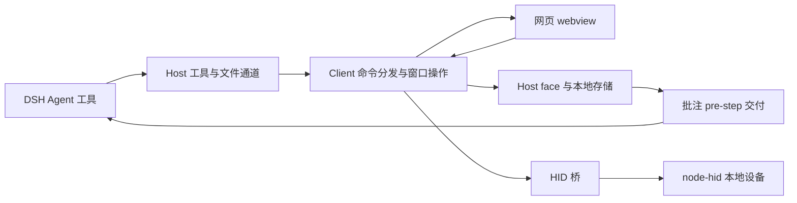

# DSH Browser Kit 全面审查报告

审查日期：2026-10-27（Asia/Shanghai）  
审查对象：`dsh-browser-kit@0.2.0`，DSH 浏览器增强插件  
最终代码基线：`92798cd1356c8991896a5ec13d22ca14e1b10155`，分支 `master`  
交付边界：审查报告、验证证据及踩坑记录；未修复产品代码，未暂存、提交或推送 Git。

## 1. 结论

**现有功能测试通过，但不建议据此批准面向任意网页的正式发布。** 本次发现的主要问题位于网页与宿主之间的信任边界、会话归属、凭据可达性及发布入口；这些问题没有被现有测试门禁覆盖。

- 最终完整测试：**279 项，278 通过、0 失败、1 跳过**，耗时约 33.75 秒。
- 30 个产品/市场脚本通过 `node --check`。
- 11 项定向验证均成功复现所检查的问题。使用当前源文件提取的真实函数、独立 Chromium 或 Node 沙箱；没有访问真实凭据、操作真实 HID 设备。
- `plugin` 生产依赖的 npm 在线审计返回 **0 项已知漏洞**。该结果不代表插件业务逻辑安全。
- 市场索引结构及官方解析器校验通过，**本地远端提交可达性门禁失败**。GitHub 实时状态未能确认。
- 问题清单：**7 项 P1、5 项 P2、1 项 P3**。其中宿主 XSS 的完整 DSH 环境利用、全新 DSH 安装及真实设备影响仍有验证边界，下文明确区分。

P1 表示发布前应优先处理，P2 表示可靠性或发布门禁问题，P3 表示维护一致性问题；这些是工程优先级，不是 CVSS 评分。未认定 P0 问题。

## 2. 范围、基线与方法

### 2.1 目录整理期间的基线变化

开始时 HEAD 为 `7250a79e00239f3863841f2aa2d51e4da50176a6`，工作区干净；随后外部整理提交 `92798cd` 将 `docs/pitfalls.md` 移回根目录，并调整 README、文档及 `package.json.files`。审查者没有执行该提交，也没有撤销它。

对开始时的 **77 个 `plugin/`、`src/`、`test/`、`market/` 已跟踪文件**逐一复核 SHA-256，最终内容均未改变。当前踩坑记录为 [pitfalls.md](../pitfalls.md)。未发现仓库中的 `.trae/rules`、`.trae/skills` 或额外的磁盘 AGENTS.md；执行要求来自用户在会话中提供的 AGENTS.md。

证据：[代码完整性](review-evidence-2026-10-27/code-integrity.json)、[初始基线](review-evidence-2026-10-27/baseline.json)。

### 2.2 审查范围

覆盖运行入口、27 个浏览器工具的注册与传输、18 个 face 方法、批注与共享状态、截图、凭据管理、HID 桥、导航策略、安装清单、市场索引、测试及维护复杂度。既有审查报告仅作为排查线索；历史“已通过”没有直接计入本次验证。

运行环境为 Windows、Node `v24.14.1`、npm `11.11.0`。真实浏览器验证使用测试工具创建的独立配置目录；未重启、切换或注入正在运行的 DSH 应用，未改写其命令文件或用户数据。

### 2.3 证据强度

| 等级 | 本报告中的含义 |
|---|---|
| 真实 Chromium | 原函数在独立真实浏览器执行；不等同于 DSH 的 CSP、webview、Cordis 生命周期全部通过 |
| 函数运行复现 | 执行原始函数，DOM、face、设备或时钟边界使用替身；证明函数行为，不证明未测的外部系统行为 |
| 制品/静态证据 | 实际清单、打包预演、源码调用链或解析器结果；明确列出尚缺的集成测试 |

## 3. 架构与已有优点

- `entry.mjs` 与 `host.impl.mjs` 分离，业务模块使用带参数的动态导入；历史缓存问题已有防线。
- 部分易错逻辑已抽入 `src/`，包括超时预算、消息胶囊落点、URL 策略和租约状态机，并有行为及副本一致性测试。
- 导航有协议白名单与 URL 用户信息拒绝策略；普通操作参数大多通过 `JSON.stringify` 注入脚本，降低字符串拼接风险。
- 截图缓存、HID 接收队列、trace、胶囊数量等已设置上限；HID 卸载清理已有真实接线，旧报告中的“完全未调用 closeAll”不再成立。
- 正常批注文本渲染大量使用 `textContent`，face 清单也有两端对账。

这些优点不能替代边界授权：**网页的全局对象与 DOM、会话参数、设备句柄、浏览器表单值，都需要在真正跨边界的位置重新校验。**

## 4. 问题总表

| ID | 优先级 | 问题 | 本次证据 |
|---|---|---|---|
| F01 | P1 | 任意网页 HID 队列可绕过设备选择/授权 | 原泵函数 + 虚拟 face 运行复现 |
| F02 | P1 | 网页提供的批注 HTML 直接进入宿主 DOM | 原镜像函数 + Chromium 脚本执行复现；DSH CSP 未测 |
| F03 | P1 | 自持窗口无会话所有权约束，目标回退可越界 | 原 scope/target 函数运行复现 |
| F04 | P1 | 凭据仅按 host 匹配，HTTPS 可降级匹配 HTTP | 原匹配函数运行复现 |
| F05 | P1 | 自动填充密码会被元素工具返回，隐私承诺不成立 | 原填充/元素 handler + Chromium；诊断通道另有复现 |
| F06 | P1 | 仓库根安装包缺少运行入口和 HID 依赖接线 | 清单、Node 解析失败、官方加载规则；全新 DSH 安装未测 |
| F07 | P1 | `npm pack` 将本机运行目录纳入制品 | 实际打包预演：202 个 `.data` 文件 |
| F08 | P2 | 宿主超时后命令仍可被客户端执行 | 实际文件通道运行复现 |
| F09 | P2 | 看门狗按周期清 busy，没有验证命令实际年龄 | 原回调对 100ms 新命令运行复现 |
| F10 | P2 | 待投递批注被覆盖，构造消息失败后也被丢弃 | 原交付注册函数运行复现 |
| F11 | P2 | 回执轮转按行数保留，不能兑现字节上限 | 实际写入函数：轮转后仍超过 3MiB |
| F12 | P2 | 市场索引的提交可达性门禁未通过 | 官方解析通过；本地 provenance 失败，远端未确认 |
| F13 | P3 | 依赖、许可证与锁文件版本元数据不一致 | 清单逐项比对 |

所有问题当前均为**未修复**。本轮完成了定位、证据与验收条件的闭环，没有将“提供修复建议”记成“问题已经关闭”。

## 5. 详细发现与修复验收条件

### F01：HID 桥信任网页可写队列，授权只在 UI 层

位置：[client.js](../plugin/client.js) L7241–7271；[hid-bridge.mjs](../src/hid-bridge.mjs) L71–133、L136–183；[webhid-shim.js](../src/webhid-shim.js) L25–63。

`pumpHidOnce` 遍历所有 webview，直接读取页面的 `window.__dshKitHidQueue`，再按 `method` 调用 `svc.hidList/Open/Read/Write/Close`。调用没有绑定经过授权的 origin、webContents、会话或设备路径；宿主句柄为全局、递增的 `hid-N`，也不包含所有者校验。

**复现**：仅在虚拟网页中创建队列，放入 `hidOpen` 与虚构设备路径；不安装 shim、不调用选择器，真实 `pumpHidOnce` 仍调用了 face 替身，并向网页返回成功。没有打开真实硬件。

影响：不可信网页可能枚举、打开本地设备，或使用其他页面的句柄读写/关闭设备。实际设备可访问性仍受操作系统与驱动影响，但桥入口本身没有权限判定。

修复：在可信宿主维护授权记录，按 **origin + webContents/文档代际 + device** 校验；句柄绑定所有者，使用不可猜测标识；导航、关闭、撤销时失效。选择器属于交互入口，不能充当授权凭证。

验收：未授权队列、跨 origin/会话句柄、导航后的旧授权全部被拒绝；已授权页面读写正常。WebHID 规范要求设备授权与用户激活，可作为设计参照：[WebHID](https://wicg.github.io/webhid/index.html)。

### F02：批注镜像将不可信网页 HTML 插入宿主

位置：[client.js](../plugin/client.js) L2043–2106，重点 L2061、L2071、L2081；[element-annotator.js](../src/element-annotator.js) L1921–1933。

宿主从网页公开的 `window.__dshKitAnnotator.mirrorSnapshot()` 获取 `html`，直接执行 `host.innerHTML = snap.html`。网页可以替换此公开函数，也能修改其返回的 DOM；正常批注使用 `textContent` 并不能保护这条跨文档入口。

**复现**：执行原 `syncAnnotMirror`，让网页边界返回包含无网络请求的无效图片及 `onerror` 标记的 HTML；独立 Chromium 中宿主标记变为 `EXECUTED`。这证明存在可执行 HTML 的信任提升。**没有在真实 DSH CSP 下执行攻击，不宣称已经证明 DSH 原生代码执行或实际秘密泄露。**

修复：镜像传输结构化批注数据，在宿主用固定组件与 `textContent` 重建；如果确需富文本，必须采用严格允许列表净化，禁止事件属性、活动内容与不受控资源 URL。CSP 作为额外防线，不能替代数据边界设计。参照：[Electron 安全建议](https://www.electronjs.org/docs/latest/tutorial/security/)。

验收：恶意 `mirrorSnapshot`、事件属性、SVG/iframe/外部资源载荷均不进入宿主活动 DOM；普通列表、清除、关闭与展开功能仍正常。

### F03：自持窗口为全局单例，会话隔离未覆盖所有路径

位置：[client.js](../plugin/client.js) L2805–2806、L3030–3041、L3907–3918、L3999–4028、L4187。

`agentView` 没有调用会话所有者字段；`target=agent` 直接返回该单例，默认也优先使用它。`scopeCheck` 只要发现任何自持窗口就放行页面动作。`guest-eval` 未列入 `PAGE_ACTIONS`，多个 handler 还使用 `inputTargetOf(c) || pickGuestEl()` 回退到全局目标。

**复现**：模拟 A 会话已打开自持窗口、B 会话没有面板。原守卫允许 B 的 `snapshot`，原目标选择器将 B 的 `target=agent` 指向 A 的窗口。这是窗口所有权缺失，和“是否共享同一个登录分区”是两件事。

修复：按会话持有窗口/标签，或在单例上明确记录所有者并拒绝其他会话；目标解析统一返回明确错误，显式指定目标失败后不得回退到其他目标；从统一命令表生成守卫覆盖清单。

验收：A/B 双会话运行读取、输入、导航、关闭、`browser_eval`；B 无目标时不得操作 A；`target=session` 缺目标时必须失败。共享登录态不能隐含授予窗口操作权限。

### F04：凭据匹配忽略协议，允许 HTTPS → HTTP 降级

位置：[client.js](../plugin/client.js) L6519–6522、L6566–6600。

`credMatch` 比较 `new URL(...).host`，而非 `origin`。因此 `https://review.example/login` 保存的凭据会匹配 `http://review.example/login`。自动填充默认开启，并会扫描自持标签。

**复现**：用上述两个虚构 URL 执行原匹配函数，返回了 HTTPS 凭据条目。

修复：按标准化 origin 匹配并默认要求 HTTPS；开发环境例外须明确配置。填充脚本执行时再次校验当前页面 origin/文档代际，防止选择目标后发生导航。

验收：协议、端口、主机变化均不匹配；HTTP 页面不会获得 HTTPS 凭据；导航竞态下也不填充。

### F05：“密码不进 Agent 上下文”未在读取端成立

位置：[client.js](../plugin/client.js) L6526–6564（填充）、L4824–4844（元素信息）、L4179–4203（页内求值）、L4383–4394（GUI 诊断求值）。

凭据保存模块不写文件，不代表填充后的值不可读。`browser_element_info` 的 handler 对所有带 `value` 的元素返回其值，包括密码框。`browser_eval` 同样拥有读取页面表单值的能力。

**复现**：在独立 Chromium 的虚构登录表单中，执行原 `fillCredential` 填入哨兵密码，再执行原 `element` handler；结果包含该哨兵的明文。另用独立 Node 沙箱确认，文件命令通道中的 `gui-eval` 能返回 GUI localStorage 的虚构哨兵。后者不是公开注册的 `browser_*` 工具，前提是调用者已有本地命令文件写入能力，不能把它描述为未登录远程接口。

修复：常规元素/快照/日志读取默认屏蔽密码及敏感字段；同时承认任意页内 eval 可以绕过简单字段屏蔽。若保留“绝不被 Agent 读取”的产品承诺，需要将凭据填充与 Agent 可执行脚本的窗口隔离，或关闭这些窗口的自动填充并建立明确授权策略。生产环境诊断入口应独立启用并受控。

验收：保存、填充、刷新、截图/快照、元素信息、console、eval、批注、错误和日志各出口做哨兵测试；报告不能只用“凭据模块没有调用 svc”的正则断言证明端到端隐私。

### F06：仓库根分发包缺少运行入口与依赖接线

位置：[根 package.json](../package.json)、[plugin/package.json](../plugin/package.json) L7–14、L32–34；[cordis.patch.yml](../plugin/cordis.patch.yml) L3–5；[hid-bridge.mjs](../src/hid-bridge.mjs) L23–35。

README 推荐安装仓库根，根清单声明 `dsh.bundle.patch=plugin/cordis.patch.yml`，patch 插入的名称为裸包名 `dsh-browser-kit`。但根清单没有 `main`、`exports`、客户端导出和运行依赖，也没有默认 `index.js`；这些声明只在子目录 `plugin/package.json` 中。

**证据**：根包清单的隔离 Node 解析返回 `MODULE_NOT_FOUND`，打包预演没有根入口。读取本机缓存的官方 DSH 0.2.1-rc.2 加载实现后确认：patch 中裸包名不会因 patch 位于 `plugin/` 而自动改为子目录入口；插件资源通过 Node 模块解析器解析。`node-hid` 只在子清单声明，普通根包安装也没有工作区/安装脚本接线去安装它。

本机 `plugin/node_modules` 已存在，开发环境链接到子包可能掩盖这些问题。**未在全新 DSH profile 实装，因此没有把宿主完整安装失败当成本次实机结果。**

修复：选定单一分发入口：根包正确导出 `plugin/entry.mjs`、client、typert、locale 并声明运行依赖，或提供完整的子包分发方案；不要仅修改 patch 路径而漏掉 client/typert 的包解析基点。

验收：从干净 Git 检出/制品安装到无开发链接的空 profile，host 激活、client 挂载、27 个工具、18 个 face 方法与 node-hid 加载全部通过；不能复用当前本机的 `plugin/node_modules` 作为证明。

### F07：本地打包会包含 `plugin/.data` 运行数据

位置：[package.json](../package.json) L38–47、[.gitignore](../.gitignore)。

`files` 对 `plugin/` 的宽泛包含使本机 `.data` 在实际 `npm pack --dry-run --ignore-scripts --json` 中被选中。**本次预演选中了 202 个运行目录文件、1,887,852 字节**，包含 `command-results.jsonl`、探测报告及临时诊断文件。`.gitignore` 未构成该打包路径的有效保护。

没有上传或发布制品，也没有复制这些运行文件的内容到审查证据。不能推断历史发布已经泄露数据；从干净 Git 拉取的安装也不自动携带当前机器未跟踪的文件。问题发生于从运行过的目录直接打包/发布等场景。

修复：采用最小发布文件白名单/干净 staging 目录，排除 `.data`、测试证据及本地脚本；在发版门禁检查实际 pack 清单，而非只检查 Git 跟踪清单。

验收：故意在运行目录放入无敏感内容的 canary，制品中仍不得出现它；干净构建与使用过的检出应产生同样的发布文件集合。

### F08：超时只结束等待，迟到命令仍会执行

位置：[browser-tools.host.mjs](../plugin/browser-tools.host.mjs) L83–138；[host.impl.mjs](../plugin/host.impl.mjs) L552–571；[client.js](../plugin/client.js) L5373–5380。

宿主超时后没有使 `command.json` 失效；`__timeoutMs` 是相对预算，没有提交时间/绝对截止时间。客户端恢复后仍可取走旧命令。另一方面，`Promise.race` 超时并不取消底层操作。

**复现**：在隔离目录调用真实 `runBrowserCommand`，等待宿主返回超时后再调用真实 `takeCommandImpl`，仍取得原 `click` 命令，信封没有到期字段。

影响：界面节流、页面挂起或短暂离线后，已经向 Agent 报告失败的点击/输入可能迟到执行；如果 Agent 重试，可能发生重复副作用。`waitChannelFree` 等待 3 秒后也不会验证旧命令是否仍占位，存在覆盖风险。

修复：信封加入绝对 deadline、取消状态及幂等标识；客户端在执行前拒绝过期命令。超时清理必须核对 id，避免删除新命令；对不可取消的输入动作要报告“结果未知”，不能暗示没有执行。

验收：客户端离线→宿主超时→客户端恢复，不产生点击；连续重试不会重复操作；旧回执不污染新命令。

### F09：看门狗会解除刚开始执行的命令锁

位置：[client.js](../plugin/client.js) L2736–2745、L5430–5438；[cmd-owner.mjs](../src/cmd-owner.mjs) L33–70。

45 秒 `setInterval` 的回调仅检查 `cmdBusy`，不比较 `cmdBusySince`。它是“每 45 秒检查一次”，不是“命令忙了 45 秒”。任何恰好临近周期末开始的命令都可能被提前复位。此外，30 秒 busy 让位规则与可合法等待 60 秒的 `browser_wait` 冲突。

**复现**：使用原回调、设置刚运行 100ms 的 busy 命令，触发一次周期检查后 busy 被清空，epoch 从 7 增至 8。没有真正等待 45 秒；验证的是定时器回调的年龄判定缺失。

修复：将取命令、执行、回执各阶段与绝对截止时间纳入同一个状态机；只在实际期限超过时恢复，恢复前处理旧执行的取消/隔离。避免租约和看门狗分别使用互相冲突的固定阈值。

验收：周期边界前 100ms 开始的命令不被清锁；60 秒合法等待不被 30 秒自救中断；真正超时可恢复且没有两个命令重叠执行。

### F10：待投递批注没有可靠队列或事务边界

位置：[annot-delivery.host.mjs](../plugin/annot-delivery.host.mjs) L218–229、L273–295。

`pending` 每个 session 只有一个值，连续登记会覆盖上一批；注入时又在 `createUserMessage` 成功之前删除记录。增量批注消费与异步 agent step 之间因此有数据丢失窗口。

**复现**：执行原注册函数并替换官方消息工厂为受控测试替身。连续登记 FIRST/SECOND 两批后只剩 SECOND；让消息工厂抛错后，pending 变为 0、成功注入仍为 0。

修复：按会话保存有界队列或按 gid 合并完整增量；消息构造成功后才确认消费，失败保留待投递记录；引入 delivery id 做幂等，撤回与队列清理同步。

验收：同一步前连续两次提交都能到达；工厂失败/重试不会丢批注或重复注入；会话关闭及撤回有明确清理语义。

### F11：回执轮转仍可留下大文件及持续同步 IO

位置：[host.impl.mjs](../plugin/host.impl.mjs) L575–598；[browser-tools.host.mjs](../plugin/browser-tools.host.mjs) L52–78、L124–128。

“超过 2MiB 后保留最后 2000 行”限制的是行数，不是字节数。单条工具结果本身可以大于阈值；结果读取每 250ms 同步读取并拆分整个文件，轮转也会同步重读重写。

**复现**：向隔离目录写入一条 3MiB 的虚构结果，触发轮转后文件仍为 **3,145,821 字节**。没有做长时间压力测试，不能由此量化真实用户场景的 CPU 消耗。

修复：限制单条结果大小，按字节而非仅行数轮转；大结果转为有权限约束的文件引用；读取使用尾部/游标或按 id 的结果存储，减少全文件同步读。

验收：单条超大结果、连续大结果及多会话压力下，文件大小和常驻内存有硬上限，回执不丢失，主线程延迟满足预先定义的预算。

### F12：市场发布门禁失败，远端有效性仍待验证

位置：[market/index.json](../market/index.json) L97；[verify-index.cjs](../market/verify-index.cjs)。

固定提交为 `6a928f521eb379c35e72ab8b0e80f68d4de41140`。本次市场验证确认其本地对象存在、结构合法，官方 `parseMarketIndex` 接受；但该提交不在本机现有远端引用的可达历史中，命令退出码为 1。

只读 `git ls-remote --heads origin` 返回 `schannel: AcquireCredentialsHandle failed: SEC_E_NO_CREDENTIALS`；Web API 查询也未取得有效响应。**本地远端引用可能陈旧，不能把验证器的“would install a 404”直接当成真实远端 HTTP 404 证据。**

修复/验收：在可正常访问远端的发布环境核验 pinned commit 可获取，确认它包含期望版本的修复，随后重跑严格 provenance 门禁并进行干净安装。索引结构校验不能代替这一过程。

### F13：元数据不一致与维护约定失真

位置：[README.md](../README.md)、[package.json](../package.json)、[plugin/package.json](../plugin/package.json)、[plugin/package-lock.json](../plugin/package-lock.json)。

- README/根包描述称“零 npm 依赖”，子包实际依赖 `node-hid`，带本地二进制安装步骤及两个传递依赖。
- 根许可证为 Apache-2.0，子包标记为 MIT；应依据实际权利与 NOTICE 统一声明，不在本审查中推断许可证法律后果。
- 子包版本为 0.2.0，锁文件根版本仍为 0.1.0。
- README 描述串行测试，但 `scripts.test` 本身为 `node --test`；本次最终门禁显式附加了 `--test-concurrency=1`，并未验证默认并发路径同样稳定。

验收：根/子包及锁文件、安装步骤、许可证说明、测试命令能够互相对账；从清单自动生成可生成的文档字段。

## 6. 安全与权限覆盖说明

| 面向 | 审查结论 |
|---|---|
| XSS | 主要已确认入口为 F02；不能用正常批注的 `textContent` 掩盖跨文档 HTML 信任问题 |
| 凭据与鉴权 | F01、F03–F05 是重点；没有证明远端未登录用户可直接访问 DSH face |
| CSRF | 本仓未实现常规 HTTP 写接口；DSH 连接认证、远端网关及会话 Cookie 的 CSRF 防线不在本次实机覆盖内 |
| SQL 注入 | 本仓未见数据库查询实现，未发现该类直接攻击面；不代表宿主或被浏览的网站已接受审计 |
| SSRF/导航 | 当前代码已有 URL 协议与用户信息限制；访问本机/内网属于开发浏览器能力，不能简单当作 SSRF 漏洞。HTTP 重定向、iframe、宿主网络策略未作完整实机矩阵验证 |
| 文件访问/上传 | 检查了路径限制、文件名处理与上传通道。普通批注读取限制文件名，删除有目录前缀检查；符号链接/Windows junction、大小限制、DSH 文件授权继承仍需专项集成测试 |
| 反序列化 | 命令为 JSON；实际危险能力在解析后的 GUI eval 与设备/窗口分发，不应将“使用 JSON”误写成整体安全 |
| 提示注入 | 网页 HTML、文本、属性会进入批注内容。应在交付协议区分用户意见与网页数据，后者按不可信内容处理；本次未运行模型攻击评估 |
| 供应链 | npm 已知漏洞为 0；安装入口、运行依赖、pack 内容和 pinned commit 仍有 F06、F07、F12、F13 问题 |

## 7. 强制性优化与 Simplify

本次为报告型审查，下列是**需要实施的优化**，没有改动产品代码，也没有声称已获得性能提升。

| 维度 | 优先动作 | 完成判据 |
|---|---|---|
| 安全 | 建立统一窗口所有权与设备授权模型；结构化镜像；凭据读写端到端控制 | F01–F05 的反向用例及 DSH 双会话实机验证通过 |
| 性能 | 回执按字节有界；增量读取；无 HID 授权时停止全 webview 高频探测 | 大结果/多标签运行测量，不靠注释或理论推断 |
| 健壮性 | 单一命令状态机、绝对 deadline、幂等结果、可靠批注队列 | 超时、恢复、重载、撤回、失败重试均无迟到副作用或丢数据 |
| 发布 | 单一分发清单、干净打包、严格 provenance 与安装测试 | 在无开发目录链接的新 profile 完整运行 |

`client.js` 为 **7,517 行 / 518,742 字节**，`element-annotator.js` 为 2,057 行。问题不只是文件长，而是命令、授权、窗口、凭据、UI 与定时器共享大量闭包状态，容易产生 F03/F09 这类跨模块契约漏洞。

建议按 KISS 顺序收敛：

1. 先统一目标解析、会话身份、deadline 与授权判定；删掉“目标不存在时找任意窗口”的回退。
2. 将命令与批注交付状态机抽成可执行测试的纯逻辑；测试聚焦外部行为及反向路径。
3. 宿主用结构化批注渲染，删除跨文档搬运 HTML 的双份 UI 状态。
4. 在验证 DSH client 不能相对 import 的现有约束后，再选择构建成单文件的源码分层方案；不要直接把当前文件拆成浏览器无法加载的相对 import。
5. 将历史事故叙述逐步移至 pitfalls/设计文档，源代码保留必要不变量与原因，降低修复后注释长期失真的概率。

建议复杂度红线：新增 handler 必须登记目标策略、权限、超时、输入/输出限额；不得新增第二套目标解析或生命周期管理；新增 fallback 必须有“不会扩大权限/执行范围”的反向测试。这些是后续建议，不冒充项目原有规范。

## 8. 测试与验收结果

| 检查 | 结果 | 证据 |
|---|---|---|
| 首轮完整测试，受限执行环境 | 279 项；275 通过、3 失败、1 跳过 | [tests-serial.txt](review-evidence-2026-10-27/tests-serial.txt) |
| 浏览器失败项在受限环境外复跑 | 4 项通过；包括额外的自备配置目录保留测试 | [browser-smoke-unrestricted.txt](review-evidence-2026-10-27/browser-smoke-unrestricted.txt) |
| 整理完成后的最终完整测试 | **279 项；278 通过、0 失败、1 跳过；exit 0** | [tests-final.txt](review-evidence-2026-10-27/tests-final.txt) |
| 定向问题验证 | **11/11 成功复现**，不是“11 个问题已修复” | [targeted-probes-browser.json](review-evidence-2026-10-27/targeted-probes-browser.json) |
| 语法检查 | 30 文件通过 | [syntax-checks.json](review-evidence-2026-10-27/syntax-checks.json) |
| npm 在线审计 | 已知漏洞 0 | [dependency-audit-live.json](review-evidence-2026-10-27/dependency-audit-live.json) |
| 打包内容 | 发现 202 个运行目录文件 | [pack-summary.json](review-evidence-2026-10-27/pack-summary.json) |
| 市场门禁 | 结构/官方解析通过，provenance 失败 | [market-validation.txt](review-evidence-2026-10-27/market-validation.txt) |
| 产品代码完整性 | 77 个产品/测试/市场文件与初始哈希相同 | [code-integrity.json](review-evidence-2026-10-27/code-integrity.json) |

最终完整测试命令为 `npm test -- --test-concurrency=1 --test-reporter=tap`。首轮三个失败分别是 annotator/HID fixture 的 `waitReady` 超时，以及 CDP 测试 WebSocket 关闭；受限环境外全部通过，不计为产品缺陷。唯一跳过项需要 DSH/Electron 运行时才能从 `app.asar` 解析真 `defineTool`，本次没有据此宣称其集成通过。

临时验证脚本放在 `test/`，执行后已删除；临时 npm 缓存与隔离数据也已清理。保留 JSON/TAP、源函数摘录、脚本哈希及复现说明，不保留可被 `node --test` 自动发现的临时脚本。

### 尚未完成的产品运行验收

- 全新 DSH profile 安装、host/client 同时激活、27 工具真实调用。
- DSH 双会话/多窗口隔离、toggle/重载/后台节流恢复。
- 实际 DSH CSP 下的恶意批注镜像测试。
- HID 真机授权、拔插、权限撤销及跨页面句柄隔离。
- 凭据功能修复后的完整隐私出口矩阵。
- 市场 pinned commit 的远端获取及安装验证。

**以上未完成项不算通过；本报告交付验收与插件发布验收必须分开。**

## 9. 建议处理顺序与交付状态

第一批处理 F01–F07，优先修补网页/设备/凭据边界与分发入口；第二批处理 F08–F11，将命令和批注消费变为明确的状态机；发布前关闭 F12 并统一 F13。每个修复都应先用本报告反例建立会失败的行为测试，再实施修复，最后补 DSH 实机证据。

| 用户要求 | 本轮状态 |
|---|---|
| Review | 已完成结构化审查、13 项清单与证据；缺陷尚未修复 |
| 强制性优化 | 已覆盖性能/安全/健壮性，提供实施及验收条件；本轮未实施代码优化 |
| Simplify | 已提出状态机、目标解析、镜像渲染与单文件构建约束下的简化路径 |
| 测试验收 | 现有完整套件通过（1 项环境跳过）；真实 DSH 产品 DoD 尚未达成 |
| 证据归档 | [证据说明与复现方法](review-evidence-2026-10-27/README.md) |
| Git | 审查者未 stage/commit/push；外部目录整理提交完整保留 |

审查报告可供评审；是否接收报告或开启修复任务，交由用户确认。不会因现有测试全绿而自动验收插件安全或批准发布。
